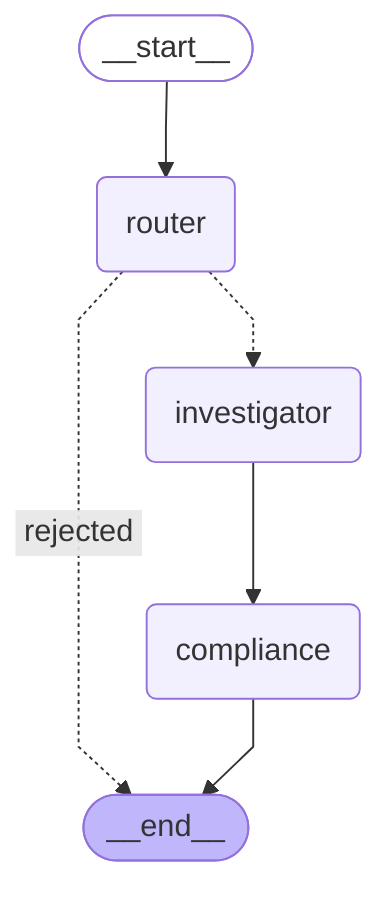

# Nexo

Graph RAG investigation service: LangGraph orchestration, a Strands Agents micro-agent, a self-hosted vLLM
model (Llama 3.3 70B), Neo4j and a vector chunk store, traced end to end with OpenTelemetry.

```
            ┌────────────── LangGraph StateGraph (checkpointed) ──────────────┐
request ──► │ router ──► investigator ─────────────► compliance ──interrupt──► │──► reviewer approves ──► answer
            │   │          │ @task: Strands Agent        (pure checks)       │
            │   ▼          │   ├─ query_knowledge_graph ──► Neo4j (READ tx)  │
            │  END         │   └─ fetch_vector_chunks  ──► chunk store       │
            └──────────────┴─────────────── vLLM (OpenAI API) ───────────────┘
ingest: document ─► heading-aware chunks ─► embeddings ─► chunk store
                                         └► vLLM triple extraction ─► evidence check ─► ontology ─► entity resolution
                                            ─► Neo4j: Document/Chunk lexical graph + entities (chunk_id on every node/edge)
```

The LangGraph workflow, generated from the compiled graph (`nexo graph`):



| Module | Code |
| --- | --- |
| A. Storage | `storage/` — `ingest.py`, `chunking.py`, `schemas.py`, `ontology.py`, `resolution.py`, `graph_store.py`, `vector_store.py`, `sensitive_data.py` |
| B. Micro-agent | `agents/` — `investigator.py` (Strands Agent), `tools.py` (the two tools) |
| C. Orchestration | `orchestration/` — `graph.py` (3 nodes), `state.py`, `compliance.py` |
| Wiring | `service.py`, `cli.py`, `telemetry.py`, `logging_setup.py`, `llm.py`, `evaluation.py` |

Full documentation lives in [`docs/`](docs/index.md) as an [Open Knowledge Format](docs/references/open-knowledge-format.md)
bundle: architecture, components, operations, decisions and references.

## Run

```bash
cp .env.example .env                                   # fill in secrets
docker compose up -d neo4j otel-collector jaeger
docker compose --profile gpu up -d                     # vLLM: needs 4x80GB GPUs
pip install -e ".[dev]"
nexo ingest corpus/memo.md --doc-type memo --effective-date 2025-06-30
nexo ask "How is Acme Holdings connected to Gamma Clinics?"   # prints thread_id + review packet
nexo review <thread_id> --approve --reviewer you@corp
```

Traces: http://localhost:16686 (Jaeger); metrics: http://localhost:8889/metrics. Telemetry follows the
[OpenTelemetry GenAI conventions](docs/references/opentelemetry-genai-conventions.md) with message content off by default
([Observability](docs/operations/observability.md)). Logs go to stdout with trace ids (`LOG_FORMAT=json` for log
pipelines). Relation ontology example: `deploy/ontology.example.json`. Neo4j Enterprise least-privilege reader:
`deploy/neo4j-rbac.cypher`.

## Run locally (macOS and Linux)

Models run natively through Ollama, chosen by a hardware profile: `m1-max-64` / `m5-pro-24` on Apple
Silicon, `gpu-24` (VRAM) or `cpu-64` on Linux. Services run in Podman or natively; either way on one
machine or two (e.g. a Linux GPU box serving the agent for a Mac):

```bash
cp deploy/local/local.env.example .env       # set LOCAL_PROFILE (and REMOTE_PROFILE for two Macs)

# One Mac
deploy/local/ollama-setup.sh m1-max-64       # pulls and preloads that profile's models

# Two Macs: the remote Mac serves agent + extraction, this one router/embeddings/judge + Nexo
deploy/local/ollama-setup.sh m1-max-64 heavy  # on the M1 Max
deploy/local/ollama-setup.sh                  # on the M5 Pro (reads LOCAL_PROFILE/REMOTE_PROFILE)
ssh -N -L 11435:127.0.0.1:11434 you@m1-max.local

podman compose up -d neo4j otel-collector jaeger   # Podman path (or: brew install neo4j)
NEXO_LIVE=1 pytest -m live -v                      # verify the models before use
```

Details: [Local on Apple Silicon](docs/operations/local-apple-silicon.md) and
[Local on Linux](docs/operations/local-linux.md) (Podman needs `-f docker-compose.linux.yml` for the Nexo
container there).

| Platform | Status |
| --- | --- |
| macOS (Apple Silicon) | Test suite passes; Podman and native paths verified up to the model server. |
| Linux | Test suite passes (verified on aarch64); Podman path uses host networking; vLLM GPU passthrough untested here. |
| Windows | Not tested; WSL2 with the Linux instructions is the likely path. |

## Test

```bash
pytest                                                  # offline: fakes only at the vLLM HTTP edge
podman run -d -p 127.0.0.1:7688:7687 -e NEO4J_AUTH=neo4j/nexo-test-pass neo4j:5.26-community
NEO4J_TEST_URI=bolt://127.0.0.1:7688 NEO4J_TEST_PASSWORD=nexo-test-pass pytest tests/test_neo4j_integration.py
```

## Production notes

- `LocalChunkStore` is single-node (hybrid BM25 + vector search in-process). Implement `ChunkStore` on PostgreSQL +
  pgvector (exact id lookup, SQL metadata filters, ACID) or OpenSearch (high QPS); both open source.
- Human review pauses must survive restarts: use `CHECKPOINT_BACKEND=postgres` with more than one replica.
- `SENSITIVE_DATA_PROVIDER=comprehend_medical` sends chunk text to Amazon Comprehend Medical; enable only where that
  flow is approved. Entity `proposed_codes` are LLM output until verified against a terminology service.

## Where LangSmith fits

Nexo emits vendor-neutral OpenTelemetry, so LangSmith plugs in as a backend rather than a second instrumentation
([ADR-0011](docs/decisions/adr-0011-langsmith-adoption.md), proposed):

| Use LangSmith for | Keep in Nexo |
| --- | --- |
| Trace UI: a second OTLP exporter in the collector (`deploy/otel-collector.yaml`), behind its content-stripping processors | Instrumentation (OTel GenAI conventions), content-capture policy |
| Evaluation: datasets, experiments, `openevals` judges, pairwise comparisons | Domain metrics as custom evaluators (triple precision/recall/capture rate, context precision/recall) |
| Studio for local graph debugging (`langgraph dev`) | The 3-node workflow and the compliance review gate (graph state is the system of record) |
| Later: reviewer decisions as feedback / annotation queues feeding datasets | Prompts in git; `Runtime` instead of Agent Server (self-hosting needs Enterprise) |

No PHI in LangSmith until a BAA is signed or LangSmith is self-hosted. Leave `LANGSMITH_TRACING` unset in the app to
avoid duplicate traces.

## Sources

The design follows these sources; each has a reference page in [`docs/references/`](docs/references/index.md) saying
what was adopted, deferred or changed.

Knowledge graph construction:
- [Claude Cookbook: knowledge graph guide](https://platform.claude.com/cookbook/capabilities-knowledge-graph-guide)
- [Memgraph: knowledge graph creation](https://memgraph.com/docs/ai-ecosystem/graph-rag/knowledge-graph-creation)
- [LangChain: constructing knowledge graphs from text using OpenAI functions](https://www.langchain.com/blog/constructing-knowledge-graphs-from-text-using-openai-functions)
- [Neo4j LLM Graph Builder](https://neo4j.com/labs/genai-ecosystem/llm-graph-builder/)
- [Neo4j: how to build a knowledge graph](https://neo4j.com/blog/knowledge-graph/how-to-build-knowledge-graph/)

RAG on AWS:
- [Retrieval Augmented Generation for healthcare use cases](https://docs.aws.amazon.com/prescriptive-guidance/latest/rag-healthcare-use-cases/introduction.html)
- [Choosing an AWS vector database for RAG use cases](https://docs.aws.amazon.com/prescriptive-guidance/latest/choosing-an-aws-vector-database-for-rag-use-cases/introduction.html)
- [Writing best practices to optimize RAG applications](https://docs.aws.amazon.com/prescriptive-guidance/latest/writing-best-practices-rag/introduction.html)

Observability, evaluation and documentation:
- [OpenTelemetry GenAI semantic conventions](https://github.com/open-telemetry/semantic-conventions-genai) and
  [OpenTelemetry Python GenAI instrumentations](https://github.com/open-telemetry/opentelemetry-python-genai)
- [LangSmith documentation](https://docs.langchain.com/langsmith)
- [Ollama](https://github.com/ollama/ollama) and its [model library](https://ollama.com/library)
- [Open Knowledge Format specification](https://github.com/GoogleCloudPlatform/knowledge-catalog/blob/main/okf/SPEC.md)
