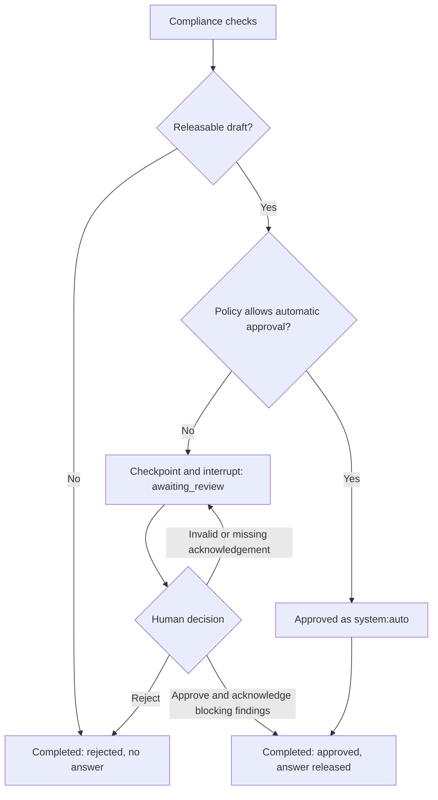
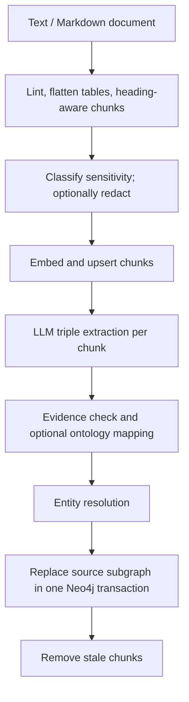

# Nexo

Graph RAG investigation service: LangGraph orchestration, a Strands Agents investigator, models on
OpenAI-compatible endpoints (Ollama or vLLM), and Neo4j for graph, chunk text and hybrid search.
Overview: [sjortiz.github.io/nexo](https://sjortiz.github.io/nexo/). Step by step, with real outputs:
[the walkthrough](https://sjortiz.github.io/nexo/walkthrough.html), also as a
[Jupyter notebook](examples/walkthrough.ipynb).

```
+------------------------ LangGraph: checkpointed (SQLite / Postgres) -------------------------+
| request -> router -> investigator -> compliance + review policy -> approved answer           |
|              |             |                 |                                               |
|              v             |                 +-> pause -> human review -> approve / reject   |
|           refused          |                 +-> failed / empty draft -> rejected            |
+----------------------------|-----------------------------------------------------------------+
                             | Strands Agent (@task)
                             +-> query_knowledge_graph --+
                             +-> find_paths -------------+-> Neo4j graph (READ transactions)
                             +-> entity_neighbours ------+
                             +-> search_chunks ----------+-> ChunkStore: Neo4j (default) / local JSON
                             +-> fetch_vector_chunks ----+
                             +-> chat: Ollama / vLLM (OpenAI-compatible API)

 ingest: document -> lint / flatten -> heading-aware chunks -> classify / optional redact
         -> embeddings + chunk upsert -> triple extraction -> evidence / ontology -> entity resolution
         -> Neo4j replace source (Document / Chunk / entities / relations) -> remove stale chunks

 request / ingest / MCP / eval -> OpenTelemetry (OTLP) -> collector -> SigNoz (traces / metrics / logs)
                                                            +-> Langfuse / Jaeger / LangSmith
                                                                (opt-in traces)
```

The router chooses graph, vector or hybrid retrieval and document/date filters; clearance comes
from the caller. The investigator uses five read-only tools to follow relationships and read the
source chunks. Ingestion stores graph evidence as `chunk_id` references to chunk text, upserting
that text before replacing the source subgraph, then removing stale chunks.

Compliance checks the draft and its citations. Review policy and the checkpointed interrupt run
inside `compliance`, not separate graph nodes. A human decision resumes compliance using the stored
investigation result. Only approval releases an answer; refusal, failed/empty output and human
rejection release none. `on-findings` is the default policy: a clean, grounded answer completes
without a person. See the [request lifecycle](docs/architecture/request-lifecycle.md),
[human review](docs/operations/human-review.md) and [glossary](docs/architecture/glossary.md).

MCP clients call retrieval tools directly against the stores and can review paused threads; they
do not run through the router or investigator. Telemetry goes through the collector to SigNoz by
default; add-ons receive traces. GenAI content stripping and the separate sensitivity gate for
question/answer logs are described in [Observability](docs/operations/observability.md).

The LangGraph workflow, generated from the compiled graph with `nexo graph --output workflow.mmd`
(no model or database services needed):


| Module | Code (under `src/nexo/`) | Responsibility |
| --- | --- | --- |
| A. Storage | [`storage/`](src/nexo/storage/) | Chunking, sensitivity, triple extraction, ontology, entity resolution, graph and chunk stores. |
| B. Investigator | [`agents/`](src/nexo/agents/) | Strands loop, five retrieval tools, evidence ledger, masking and budgets. |
| C. Orchestration | [`orchestration/`](src/nexo/orchestration/) | Routing, checkpointed investigation, deterministic checks and review policy. |
| Runtime and CLI | [`service.py`](src/nexo/service.py), [`cli.py`](src/nexo/cli.py), [`llm.py`](src/nexo/llm.py), [`aio.py`](src/nexo/aio.py) | Resource lifetimes, model roles, ingest/ask/review/status, servers and sync-to-async bridging. |
| MCP and review surfaces | [`mcp_server.py`](src/nexo/mcp_server.py), [`mcp_review.py`](src/nexo/mcp_review.py), [`review_ui.py`](src/nexo/review_ui.py), [`review_inbox.py`](src/nexo/review_inbox.py) | Retrieval, confirmed MCP reviews, demo page and Agent Inbox adapter. |
| Setup | [`setup/`](src/nexo/setup/), [`config.py`](src/nexo/config.py), [`secret_store.py`](src/nexo/secret_store.py), [`local_profiles.py`](src/nexo/local_profiles.py) | Setup schema, lock/render/check/up, settings, secrets and hardware profiles. |
| Telemetry and evaluation | [`telemetry.py`](src/nexo/telemetry.py), [`logging_setup.py`](src/nexo/logging_setup.py), [`evaluation.py`](src/nexo/evaluation.py) | OpenTelemetry, correlated logs and retrieval/generation/extraction scores. |

Full documentation lives in [`docs/`](docs/index.md) as an [Open Knowledge Format](docs/references/open-knowledge-format.md)
bundle: architecture, components, operations, decisions and references.

## Run

From the checkout, with `uv`, a container engine (Podman or Docker) and model servers. Pick your path:

| Machine | Preset | Guide |
| --- | --- | --- |
| Apple Silicon Mac, services in Podman | `mac-single` (`mac-two-machines` for two Macs) | [Local on Apple Silicon](docs/operations/local-apple-silicon.md) |
| Apple Silicon Mac, bare-metal core | `mac-native` | [Native path](docs/operations/local-apple-silicon.md#native-path) |
| Linux, GPU or CPU, Ollama | `linux-gpu`, `linux-cpu`, `linux-native` | [Local on Linux](docs/operations/local-linux.md) |
| Linux GPU server, vLLM (4x80 GB) | `linux-vllm` | below, and [Compose stack with vLLM](docs/operations/local-stack.md) |

`make env PRESET=...` writes `nexo.yaml` with this machine's hardware profile; `make up` starts it;
`make check` says what is missing. The GPU-server flow:

```bash
uv sync                                      # Python 3.12 from .python-version; deps from uv.lock
source .venv/bin/activate
make env PRESET=linux-vllm                    # Linux NVIDIA setup; add HF_TOKEN to .env
make up                                      # Neo4j, collector, SigNoz and vLLM (4 x 80 GB GPUs)
make check                                   # preflight, ports, review/content policy and model roles
nexo ingest examples/corpus/acme-portfolio-note.md --doc-type memo --effective-date 2025-06-30
nexo ingest examples/corpus/gamma-supplier-review.md --doc-type memo
nexo ask "How is Acme Holdings connected to Gamma Clinics?"
```

For Ollama on a Mac or Linux, use a preset [below](#run-locally-macos-and-linux). For vLLM requirements
and container CLI use, see [Compose stack with vLLM](docs/operations/local-stack.md).
`make env` keeps an existing `nexo.yaml` and creates missing secrets in `~/.config/nexo/config` by
default. `nexo config --explain` shows where each setting comes from. `nexo setup` resolves `nexo.lock` and renders `.nexo/render/`; edit the setup file, not its
rendered files ([ADR-0016](docs/decisions/adr-0016-declarative-setup-file.md)). Settings and precedence:
[Configuration](docs/operations/configuration.md).

Investigation and ingestion results go to stdout as JSON; logs go to stderr with trace ids
(`LOG_FORMAT=json` for log pipelines). `status: completed` means the thread ended, including
rejection: read `approval_status` and `outcome`, such as `approved by system:auto`,
`rejected by you@corp` or `rejected: no releasable output`.

### Review

`spec.review` in `nexo.yaml` sets `REVIEW_POLICY`:

| Policy | Approved without a person | Pauses for review |
| --- | --- | --- |
| `on-findings` (default) | No findings, at least one citation, every cited chunk fetched | Any finding |
| `always` | None | Every releasable draft |
| `never` | No findings or only warnings | Any finding other than a warning |

No policy auto-approves a blocking finding. Failed or empty investigations are rejected without a
review step. Policy approvals are recorded as `reviewer: system:auto`.



Only for a paused thread (replace `THREAD_ID` with its id):

```bash
nexo status THREAD_ID
nexo review THREAD_ID --approve --reviewer you@corp
# To approve blocking findings, also pass --acknowledge-findings.
```

Review is also available over MCP. The optional [Agent Inbox](docs/operations/agent-inbox.md) uses
`make up AGENT_INBOX=1` plus `make review-inbox`; `nexo review-ui` is a loopback-only demo with no
authentication and is not started by `make up`. See [Human review](docs/operations/human-review.md).

### Ingestion



Graph evidence points to a stored `chunk_id`. `ingest()` requires both a chunk store and a graph
writer; without either it raises `ValueError`. Use `extract_triples()` for extraction without writes
or entity resolution. Failed chunks remain readable and are listed in the report; the ingest CLI
exits non-zero. See [Ingestion pipeline](docs/components/ingestion-pipeline.md). Relation ontology
example: `deploy/ontology.example.json`.

## Use from Claude Code (MCP)

`nexo mcp` serves seven read-only retrieval tools: index, hybrid search, chunks, entities, neighbors,
paths and Cypher. Three review tools are on by default; submitting a review requires the person to confirm a
client elicitation form. Clients without forms are directed to the CLI. Set `MCP_REVIEW_TOOLS=false`
for retrieval only. The repository ships `.mcp.json` and a `nexo-knowledge` skill:
[Use from Claude Code](docs/operations/claude-code.md).

One server has one clearance (`MCP_CLEARANCE`, otherwise `DEFAULT_CLEARANCE`). Eligible chunks above
it only because of detected PII are shown with those spans masked; other chunks above clearance,
including PHI, are withheld. Search masks the query and requires matches in the visible
text, excluding masked values and their fragments. Ranking still uses the stored text. Graph map
redaction does not catch scalar Cypher projections or computed keys on Neo4j Community; Enterprise
roles are needed to enforce those restrictions. Details and limits:
[MCP server](docs/components/mcp-server.md).

The default transport is stdio (stdout carries JSON-RPC). `nexo mcp --transport streamable-http`
binds `127.0.0.1:8765` without authentication; use an authenticating proxy before exposing it.
The CLI manages store and runtime lifetimes; server commands keep them open while serving.

## Run locally (macOS and Linux)

Ollama runs natively; Neo4j, the collector and SigNoz run in containers, or with `target.mode: native`
(`mac-native`, `linux-native`) Neo4j is a Homebrew or system service and Nexo runs from the `.venv`: a
bare-metal core, with containers only for telemetry and add-ons. `spec.models.local.profile`
in `nexo.yaml` matches the machine: for example `m1-max-64` / `m5-pro-24` on Apple Silicon,
`gpu-24` (VRAM) or `cpu-64` (RAM) on Linux. `make env` detects it; pass `PROFILE=` to override.

```bash
make env PRESET=mac-single                   # or linux-cpu / linux-gpu; PROFILE= overrides the detected one
make up                                     # pull/start the profile's models and container services
make check

# One Mac, bare-metal core: Homebrew's Neo4j, Ollama and Nexo from the .venv (telemetry in containers)
make env PRESET=mac-native && make neo4j-init && brew services start neo4j
make up && make check
```

For two Macs, the remote machine serves agent/extraction and this one serves router/embeddings/judge
(when enabled):

```bash
deploy/local/ollama-setup.sh m1-max-64 heavy   # on the remote Mac
make env PRESET=mac-two-machines             # on this Mac; set both profiles
ssh -N -L 11435:127.0.0.1:11434 you@m1-max.local  # keep running in another terminal
make up
make check
```

Presets: `mac-single`, `mac-two-machines`, `mac-native`, `linux-cpu`, `linux-gpu`, `linux-native`,
`linux-vllm`
([`examples/setups/`](examples/setups/)). `docker-compose.yml` is generated from `mac-single`
by `make compose-file`; prefer `make up` to supply secrets from the provider. Published ports are
configurable through `spec.ports`; URLs here use the defaults.

Which preset, models and add-ons to pick, with memory per combination:
[Choosing a setup](docs/operations/decision-guide.md). Roles, profiles, ports and setup commands:
[How local setup works](docs/operations/local-setup.md). Step by step:
[Local on Apple Silicon](docs/operations/local-apple-silicon.md) and
[Local on Linux](docs/operations/local-linux.md) (the Nexo container uses host networking on Linux).
Windows has no dedicated setup; see the [FAQ](docs/operations/faq.md) and
[troubleshooting](docs/operations/troubleshooting.md).

Neo4j 5.26 Community is the compose and CI default; chunk search uses the `db.index.*.queryNodes`
procedures. Neo4j 2026.09+ Community is supported too (integration tests pass on 2026.09 and
2026.10) and uses the `SEARCH` clause: [Chunk store](docs/components/chunk-store.md#neo4j-versions).
`target.mode: native` is covered by tests, not yet run end to end.

## Test

```bash
make test          # offline suite; real Neo4j tests also run if NEO4J_TEST_URI is set
make test-neo4j    # integration tests on a throwaway Neo4j (127.0.0.1:7688)
make test-live     # real model servers required
```

Suites and prerequisites: [Testing](docs/operations/testing.md). `make` lists every task.

`nexo eval` runs the investigator directly, skipping routing, compliance and review. It writes JSONL
retrieval and answer scores, plus optional faithfulness/relevancy scores when `JUDGE_MODEL` is set:

```bash
nexo eval examples/golden/acme-gamma.jsonl > results.jsonl  # ingest both sample documents first
nexo eval-extraction gold.jsonl                          # your text + gold triples; no store writes
```

Cases can set strategy and clearance; the judge receives cited evidence masked or withheld at that
clearance. Scores are emitted as OpenTelemetry metrics and span attributes. With the Langfuse add-on,
evaluation traces reach Langfuse; the current CLI does not create Langfuse datasets or experiments.
Dataset format and judge setup: [Evaluation playbook](docs/operations/evaluation.md).

## Production notes

- `Neo4jChunkStore` is the default: graph, chunk text, embeddings, vector and full-text indexes in one
  database. `LocalChunkStore` is an in-process JSON alternative for offline runs and tests, not shared
  storage. `nexo chunks status` finds graph chunks without text; `nexo chunks import` migrates an old
  local store. See [Chunk store](docs/components/chunk-store.md).
- Review checkpoints use per-stack SQLite by default. For multiple replicas, install the `postgres`
  extra (`uv sync --extra postgres`), set `CHECKPOINT_BACKEND=postgres` and `CHECKPOINT_POSTGRES_URI`.
- Use an Enterprise reader account for database-enforced least privilege (`deploy/neo4j-rbac.cypher`).
  Cypher guards and READ transactions alone do not enforce property-level clearance.
- Mount cluster secrets as files, or use SOPS / Vault through `spec.secrets`; the OS keychain is a
  local opt-in. See [Choosing a setup](docs/operations/decision-guide.md#9-where-secrets-live).
- `SENSITIVE_DATA_PROVIDER=comprehend_medical` sends text to Amazon Comprehend Medical; enable only
  where that flow is approved. Regex detection does not cover all PHI. Entity `proposed_codes` remain
  LLM output until verified against a terminology service. See
  [Sensitive data detection](docs/components/sensitive-data-detection.md).

## Observability

Nexo emits vendor-neutral OpenTelemetry following the
[GenAI conventions](docs/references/opentelemetry-genai-conventions.md). The collector sends traces,
metrics and logs to self-hosted [SigNoz](docs/references/signoz.md), the default backend
([ADR-0015](docs/decisions/adr-0015-signoz-default-observability.md)). UI: http://localhost:8080;
log in with `SIGNOZ_USER_EMAIL` / `SIGNOZ_USER_PASSWORD` from the secrets provider
(`~/.config/nexo/config` by default). Raw metrics: http://localhost:8889/metrics. Host/container metrics
are on by default; on macOS these describe the container VM, not native Ollama.

GenAI prompt/output capture is off by default, and the collector strips GenAI message content.
Separately, `spec.telemetry.content` (default `internal`) gates export of the question, released
answer, reviewer comment and routing reason by the highest sensitivity of chunks read and detector
findings in that text. No detector (`SENSITIVE_DATA_PROVIDER=none`) or a failing detector withholds
this content. Set `spec.telemetry.content` to `none` to disable these content records.
Explicit GenAI content capture bypasses the gate, and `spec.telemetry.queryText: true`
(`TRACE_QUERY_TEXT=true`) records query text outside it. The `nexo.content` logger stays at INFO for OTLP;
stderr still follows `LOG_LEVEL` and omits the text. `OTEL_CONSOLE_EXPORT=true` prints spans to
stderr, including released content events. See
[Observability](docs/operations/observability.md#question-and-answer-logs).

Opt-in trace add-ons, each a collector pipeline:

| Add-on | Start | Notes |
| --- | --- | --- |
| Langfuse | `make up LANGFUSE=1` | LLM observations; UI on http://localhost:3000. Datasets/experiments are separate from the CLI scores. |
| Jaeger | `make up JAEGER=1` | Span UI on http://localhost:16686. |
| LangSmith | `make up LANGSMITH=1` | Needs `LANGSMITH_API_KEY` in `.env`; project is `spec.addons.langsmith.project`. |

Add-ons can be combined. These switches apply to one run; `spec.addons` in `nexo.yaml` keeps them on.
Which to use when: [Choosing a setup](docs/operations/decision-guide.md#4-which-observability-to-turn-on).
Self-hosted trace backends receive sensitivity-released `nexo.content` events; the LangSmith pipeline
removes them and query text. Leave `LANGSMITH_TRACING` unset to avoid duplicate app-side traces.
For Studio and separate LangSmith evaluation tooling, see [the reference](docs/references/langsmith.md).
No PHI in hosted LangSmith without an appropriate agreement. Full span, metric and export details:
[Observability](docs/operations/observability.md).

## Sources

The design follows these sources; each has a reference page in [`docs/references/`](docs/references/index.md) saying
what was adopted, deferred or changed.

Core stack:
- [LangGraph](https://docs.langchain.com/oss/python/langgraph/overview) - orchestration
- [Strands Agents](https://strandsagents.com/docs/) - the investigator agent
- [LangChain](https://docs.langchain.com/oss/python/langchain/overview) - model clients, splitters, vector index
- [vLLM](https://docs.vllm.ai/en/latest/) - GPU inference
- [Neo4j](https://neo4j.com/docs/python-manual/current/) - graph database and driver

Knowledge graph construction:
- [Claude Cookbook: knowledge graph guide](https://platform.claude.com/cookbook/capabilities-knowledge-graph-guide)
- [Memgraph: knowledge graph creation](https://memgraph.com/docs/ai-ecosystem/graph-rag/knowledge-graph-creation)
- [LangChain: constructing knowledge graphs from text using OpenAI functions](https://www.langchain.com/blog/constructing-knowledge-graphs-from-text-using-openai-functions)
- [Neo4j LLM Graph Builder](https://neo4j.com/labs/genai-ecosystem/llm-graph-builder/)
- [Neo4j: how to build a knowledge graph](https://neo4j.com/blog/knowledge-graph/how-to-build-knowledge-graph/)

RAG on AWS:
- [Retrieval Augmented Generation for healthcare use cases](https://docs.aws.amazon.com/prescriptive-guidance/latest/rag-healthcare-use-cases/introduction.html)
- [Choosing an AWS vector database for RAG use cases](https://docs.aws.amazon.com/prescriptive-guidance/latest/choosing-an-aws-vector-database-for-rag-use-cases/introduction.html)
- [Writing best practices to optimize RAG applications](https://docs.aws.amazon.com/prescriptive-guidance/latest/writing-best-practices-rag/introduction.html)

Observability, evaluation and documentation:
- [OpenTelemetry GenAI semantic conventions](https://github.com/open-telemetry/semantic-conventions-genai) and
  [OpenTelemetry Python GenAI instrumentations](https://github.com/open-telemetry/opentelemetry-python-genai)
- [SigNoz](https://signoz.io/docs/) - default observability backend
- [Langfuse self-hosting](https://langfuse.com/self-hosting) - evaluation add-on, with
  [SeaweedFS](https://github.com/seaweedfs/seaweedfs) for its S3 storage
- [LangSmith documentation](https://docs.langchain.com/langsmith)
- [Model Context Protocol](https://modelcontextprotocol.io/) and its [Python SDK](https://github.com/modelcontextprotocol/python-sdk)
- [Ollama](https://github.com/ollama/ollama) and its [model library](https://ollama.com/library)
- [Open Knowledge Format specification](https://github.com/GoogleCloudPlatform/knowledge-catalog/blob/main/okf/SPEC.md)

## License

[MIT](LICENSE).
