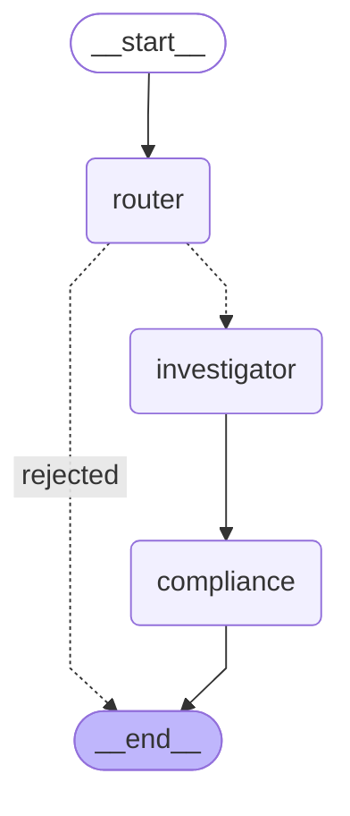

# Topology

Generated from the compiled graph (`nexo graph`); a test fails if this copy drifts from the code.



The edges are fixed; only the router's conditional edge (dotted) branches: `rejected` ends the run,
anything else goes to the investigator. The compliance node pauses with `interrupt()` for human
approval unless the [review policy](../operations/human-review.md#review-policy) approves the answer;
under the default, `on-findings`, an answer with any finding pauses. State keys are listed in
[Request lifecycle](../architecture/request-lifecycle.md#state).[^state]

# Nodes

**router** (validator)

- Deterministic gate first: empty query, or longer than `MAX_QUERY_CHARS` (2000) → `rejected`.
- Then the router LLM returns a `RouteDecision`: `target`, `reason`, `strategy`
  (`graph`/`vector`/`hybrid`), optional `doc_types`, `effective_from`, `effective_to`.
- Out of scope: writes, bulk export of personal records, prompt extraction, unrelated tasks.
- Fails closed: if the router LLM is unreachable or returns invalid output twice, the request is
  `rejected` with `router unavailable (...)`. The agent is never called with an unvalidated request.
- The scope's `max_sensitivity` is the caller's clearance, not a model output.

**investigator** — runs the [Strands agent](investigator-agent.md) in a checkpointed `@task`; see
[the handoff](../architecture/langgraph-strands-handoff.md).

**compliance** — runs [compliance checks](compliance-checks.md). Unless the
[review policy](../operations/human-review.md#review-policy) approves the answer as `system:auto`, it
then pauses with `interrupt()`, passing a `ReviewPacket` as JSON:[^state]

```json
{"request_id": "...", "user_query": "...", "draft_answer": "...", "citations": ["chk_..."],
 "compliance_report": {"findings": [...], "blocking": false},
 "resume_with": {"...ReviewDecision JSON schema..."}}
```

Resume value (`ReviewDecision`):

```json
{"approval_status": "approved", "reviewer": "analyst@corp", "comment": "ok", "acknowledged_findings": false}
```

Invalid input, or approving blocking findings without `acknowledged_findings: true`, calls
`interrupt()` again with an `error` key. Everything before `interrupt()` is pure, because LangGraph
re-executes the node from the top on resume.[^graph]

# Guarantees (tested)

Resume does not re-run the agent; rejected requests never reach it; the router cannot raise clearance;
a transient vLLM error retries the investigation once; a review survives a process restart with the
SQLite checkpointer; one trace covers request, nodes and the agent.[^test-graph]

[^graph]: build_graph
[^state]: GraphState, RouteDecision, ReviewDecision, ReviewPacket
[^test-graph]: Orchestration tests
